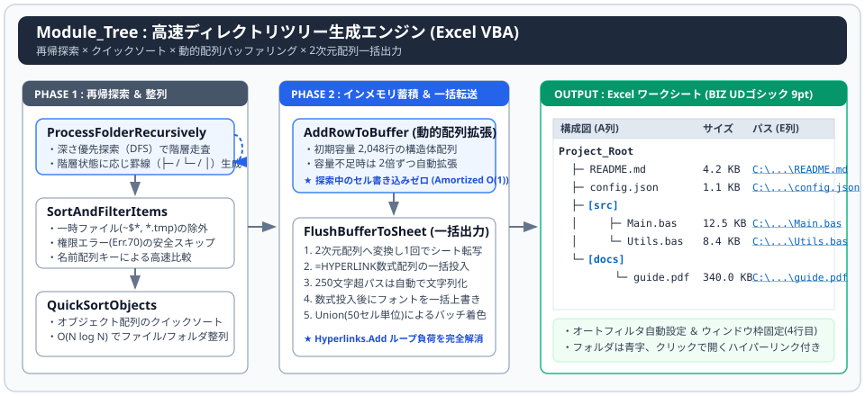

<h4 align="center">Excel VBA ディレクトリツリー生成ツール (Module_Tree)</h4>

<p align="right">
  <sub>作成日: 2026年11月01日 / 作成者: System beginner & AI Collaborator (Gemini)</sub>
</p>

<p align="center">
  
</p>

指定したフォルダ配下のファイル・サブフォルダ構造を解析し、罫線（`├─` / `└─` / `│`）を用いたツリー形式とハイパーリンク付き一覧表としてExcelシートへ高速出力するVBAモジュールです。

---

### なぜ今、あえて「Excel VBAでツリー作成」なのか？

コマンドプロンプトの tree /f や専用ツールでもフォルダ構成は出力できますが、実務環境における以下の要件を満たすために本モジュールを作成しました。

1. **PC環境の制限への対応**： セキュリティポリシーにより外部ツールの導入やスクリプト実行が制限されている環境でも、Excelがあれば単一モジュール（.bas）のインポートのみで動作します。
2. **管理台帳としての二次利用**： 単なるテキスト出力ではなく、「更新日時」「ファイルサイズ（KB）」「対象を開くハイパーリンク」「オートフィルタ」を備えたExcel一覧表として出力するため、設計書や棚卸し台帳へそのまま転用できます。
3. **VBAアルゴリズムと高速化技法のリファレンス実装**： セル単位の書き込みでは処理時間が増大する「ファイル走査とシート出力」に対し、**再帰（深さ優先探索）・クイックソート・動的配列の倍々拡張・2次元配列一括出力・Unionバッチ着色**を組み合わせた構成としています。

---

### 主な機能と特徴

* **ツリー罫線の自動描画**： 親階層の継続状態（後続フォルダの有無）を再帰呼び出し時に引き継ぎ、`├─`、`└─`、`│` を正確に使い分けます。
* **インメモリ蓄積＆一括出力による圧倒的な高速化**： フォルダ探索中はシートへの書き込みを一切行わず、動的構造体バッファへ蓄積した後に1回の配列転写で出力します。
* **ハイパーリンク高速生成と255文字制限の自動回避**： 低速な Hyperlinks.Add メソッドのループ呼び出しを排し、=HYPERLINK() 数式配列の一括投入を採用しています。250文字を超える長大なパスは自動的にプレーンテキスト（グレー字）へ切り替わり、数式エラーを防ぎます。
* **システムファイル・一時ファイルのスマート除外**： Thumbs.db の常時除外に加え、実行時の選択で Office 一時ファイル（~$*, *.tmp）をフィルタリングできます。
* **アクセス制限フォルダ（エラー70）の安全スキップ**： 権限のないシステムフォルダ等に遭遇してもマクロが異常終了せず、安全にスキップして走査を継続します。

---

### 高速化のためのポイント（従来との比較）

| 処理項目 | 従来のVBA実装 | 本モジュール (`Module_Tree`) の実装 |
| :--- | :--- | :--- |
| セルへの値出力 | 1ファイルごとに Cells(r, c).Value へ個別書き込み | 構造体バッファ（容量不足時は2倍拡張）に蓄え、2次元配列で一括出力 |
| 整列（ソート） | コレクション順（順不同）またはバブルソート $O(N^2)$ | 名前配列をキーとした **クイックソート $O(N \log N)$** |
| ハイパーリンク設定 | 行ループ内で毎回 ws.Hyperlinks.Add を実行（処理遅延の主因） | =HYPERLINK("path","path") 数式を2次元配列で一括投入 |
| フォントスタイルの維持 | ハイパーリンク設定時にブック標準スタイル（游ゴシック 11pt）が自動適用される | 数式の一括投入**後**に、列全体へ `BIZ UDゴシック 9pt` を一括上書き |
| フォルダ行の青字化 | 行ごとに .Font.Color を変更 | Union で対象セルを束ね、50セル単位でバッチ適用（Unionの肥大化を防止） |

* _<sub>**再帰探索（深さ優先探索）と状態引き継ぎ：** 親階層の「最終要素かどうか（isLastFolder）」に応じて、次階層へ渡すインデント文字列（縦線 `│` または空白）を動的に切り替えることで、階層間の罫線を連結しています。</sub>_
* _<sub>**動的配列の倍々拡張（Amortized $O(1)$）：** 要素数が事前に分からないフォルダ走査において、ReDim Preserve を毎回実行するのではなく容量不足時に2倍ずつ拡張することで、メモリ再確保のオーバーヘッドを抑えています。</sub>_
* _<sub>**Excelオブジェクトモデルの仕様と通信負荷への対策：** セルへの個別アクセスを排した2次元配列の一括転写、数式投入後に自動適用される標準スタイルの事後上書き、および Union の要素増加による速度低下を防ぐ50セル単位のバッチ着色により、処理速度と書式維持を両立しています。</sub>_

---

### 出力フォーマット

シートの3行目にヘッダーが生成され、4行目（ウィンドウ枠固定）からルートフォルダおよび配下のツリーが出力されます。

| 列 | 項目名 | 出力内容・書式 |
| :---: | :--- | :--- |
| A列 | 構成図 | ツリー罫線 ＋ ファイル名（サブフォルダは `[フォルダ名]` で青字表示） |
| B列 | ファイル名 | 拡張子を除いたベースファイル名 |
| C列 | 更新日時 | yyyy/mm/dd hh:mm:ss（文字列・右揃え） |
| D列 | サイズ | #,##0.0 KB（右揃え） |
| E列 | パス（ハイパーリンク） | フルパス（クリックで対象ファイルを開く。長パスはグレー表示） |

---

### 処理フロー図

処理は「初期設定とルート取得」「再帰的フォルダ探索とメモリバッファ蓄積」「シートへの一括出力と書式適用」「レイアウト調整と終了処理」の4フェーズで進行します。

```text
[VBAからの呼び出し窓口]
 └─ CreateFileTreeList               (メインプロシージャ：全体制御)
      │
      ├─ 1. [初期設定とルート取得]
      │   ├─ MsgBox                  (一時ファイル除外設定の確認)
      │   ├─ FileDialog              (対象ルートフォルダの選択)
      │   ├─ InitializeSheet         (シート初期化・ヘッダー生成・枠固定)
      │   └─ ReDim mBuffer           (動的メモリバッファの初期確保：2,048行)
      │
      ├─ 2. [再帰的フォルダ探索とメモリバッファ蓄積]
      │   └─ ProcessFolderRecursively (親フォルダ, 現在インデント)    <───┐ [再帰呼び出し]
      │        │                                                        △
      │        ├─ SortAndFilterItems (Files) 
      │        │   ├─ 除外判定       (Thumbs.db, ~$*, *.tmp のスキップ) 
      │        │   └─ QuickSortObjects (ファイル名昇順のクイックソート) 
      │        │ 
      │        ├─ SortAndFilterItems (SubFolders) 
      │        │   ├─ 権限エラー検知 (エラー70発生時は安全にEmpty返却) 
      │        │   └─ QuickSortObjects (フォルダ名昇順のクイックソート) 
      │        │ 
      │        ├─ [A] ファイル群の走査ループ
      │        │   ├─ 枝記号の決定   (最終要素なら "└─" / 他は "├─")
      │        │   └─ BufferFileInfo
      │        │       └─ AddRowToBuffer (RowType=0:通常 / 2:長パス) 
      │        │ 
      │        └─ [B] サブフォルダ群の走査ループ 
      │            ├─ 枝記号の決定   (最終要素なら "└─" / 他は "├─") 
      │            ├─ AddRowToBuffer (RowType=1:フォルダ行 [フォルダ名])
      │            ├─ 次階層インデントの生成
      │            │   ├─ 最終フォルダの場合 ： indent + "      " (空白)
      │            │   └─ 後続がある場合     ： indent + "  │   " (縦線)
      │            │                                                     △
      │            └─ ProcessFolderRecursively (子フォルダ, 次インデント)  ─┘
      │
      ├─ 3. [シートへの一括出力と書式適用]
      │   └─ FlushBufferToSheet
      │        ├─ 2次元配列の構築    (A〜D列の値配列 / E列のHYPERLINK数式配列)
      │        ├─ 配列の一括書き込み (Resize.Value / Resize.Formula)
      │        ├─ フォント一括上書き (数式適用後に BIZ UDゴシック 9pt を再適用)
      │        └─ Unionバッチ着色    (50セル単位でフォルダ青字・長パス灰字を適用)
      │
      └─ 4. [レイアウト調整と終了処理]
          ├─ Columns("A:A").AutoFit  (列幅自動調整と最大幅70の制限適用)
          ├─ Range.AutoFilter        (A3:E最終行へオートフィルタ設定)
          └─ RestoreSettings         (バッファ解放・Excel環境設定の復元)
```

---

🔗 **関連プロジェクト（GitHub リポジトリ）：**

<sub>VBA × PowerShell × WebView2 による汎用Web RPA操作エンジン ＆ DOM要素ビューアー</sub><br>
https://github.com/sundayCODEage/vba-ps-webview2-rpa-engine

---

### 📜 ライセンス (License)
This project is licensed under the MIT License - see the [LICENSE](LICENSE) file for details.<br>
このプロジェクトは **MIT License** の下で公開されており、改変・組み込みも自由に行えます。詳しくは [LICENSE](LICENSE) ファイルをご覧ください。
